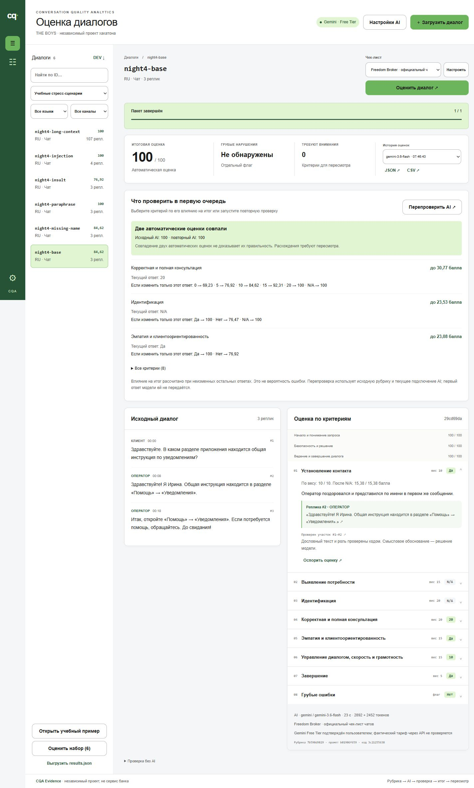
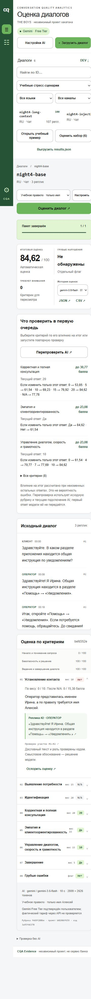

# CQA Evidence · THE BOYS

Приложение для проверки качества диалогов Freedom Broker по восьми критериям: AI предлагает ответы с опорными репликами, программа проверяет свидетельства и рассчитывает итог, эксперт может оспорить решение. Интерфейс — независимый проект хакатона, оформленный по актуальным визуальным референсам Freedom Bank; это не официальный банковский сервис.



**[Открыть облачное демо](https://cqa-evidence-the-boys.onrender.com)** · [Инструкция для жюри](submission/README.md) · [Текст заявки](submission/APPLICATION.md). Код доступа команда передаёт в заявке. Демо работает на Render Free с отдельными временными сеансами и новыми серверными ключами Gemini/Groq. Реальные внешние вызовы обоих провайдеров проверены. [Размещение и ограничения](docs/deployment/README.md). Официальный контрольный прогон сохраняет результаты локально.

## Запуск

Требуется **Python 3.11+**. Зависимости приложения — только стандартная библиотека Python, SQLite и браузер; `pip install` и `npm install` не нужны. Из корня клонированного репозитория:

```powershell
git clone https://github.com/NuraliKuzhagaliev/data.git
cd data
python -m cqa serve
```

Откройте [127.0.0.1:8765](http://127.0.0.1:8765). Остановка — Ctrl+C. Если порт занят: `python -m cqa serve --port 8770`. На Windows также доступен `powershell -File .\start.ps1`. Приложение слушает только loopback; это рабочее место одного проверяющего, не публичный многопользовательский сервер.

### Бесплатный облачный AI

1. В «Подключить AI» выберите Gemini или Groq, укажите модель и ключ своего аккаунта, подтвердите Free Tier/Free Plan **без платного биллинга**, сохраните название команды.
2. Основная проверенная настройка: Gemini, запрошенная модель `gemini-3.5-flash`. Во время проверок API сообщал фактическую версию `gemini-3.6-flash`: оба имени сохраняются. Проверенные альтернативы Groq — `openai/gpt-oss-120b` и `qwen/qwen3.8-27b`. Доступность конкретной модели зависит от аккаунта и сервиса.
3. Ключи получают в [Google AI Studio](https://aistudio.google.com/apikey) или [Groq Console](https://console.groq.com/keys). Ключ вводится только локально; после сохранения API возвращает браузеру лишь признак наличия. Настройки и база находятся в исключённой из Git папке `.local/`. Хранение ключей — локальный файл, не системный защищённый vault.

Без ключа доступны загрузка, редактор рубрики и явно обозначенная **MOCK-проверка интерфейса**. Она не является AI-анализом и не допускается в официальный экспорт. Программа не определяет тариф аккаунта и не отключает биллинг у провайдера: подтверждение пользователя обязательно. Запросы передают текст внешнему сервису. Для бесплатных сервисов Gemini Google предусматривает использование входов и ответов для улучшения продуктов с оговорёнными территориальными исключениями — см. [условия](https://ai.google.dev/gemini-api/terms). Все новые эксперименты этого цикла выполнены на собственных синтетических данных.

### Настройка через `.env`

Это альтернатива форме. В PowerShell:

```powershell
Copy-Item .env.example .env
# Откройте .env в редакторе, вставьте свой ключ и подтвердите соответствующий бесплатный тариф.
python -m cqa serve
```

В `.env.example` перечислены все поддерживаемые параметры, ключи пустые, подтверждения тарифа по умолчанию `false`. Приоритет: значения по умолчанию → `.env` → сохранённые настройки UI → явные переменные процесса. Парсер не исполняет команды и не раскрывает shell-подстановки. Не публикуйте `.env` и `.local/`.

## Работа с диалогом

1. «Загрузить диалог»: JSON организаторов, массив диалогов, массив реплик или текст с ролями и временем. Для первого знакомства есть «Открыть учебный пример». Сырой организаторский DEV в репозитории отсутствует; кнопка «DEV ↓» использует только отдельно полученный локальный `.local/dev.json`.
2. Выберите диалог и рубрику. При необходимости измените правило, тип, шкалу, вес или условие N/A; сохранение создаёт новую версию. «Оценить диалог» либо «Оценить набор» запускает реальный запрос.
3. Откройте критерий, прочитайте основание и перейдите к исходной реплике. AI выбирает ID; цитата и роль извлекаются из исходника. Неполный охват для `critical=NO`, чужая роль, выдуманная ссылка или недопустимая ступень отвергаются.
4. Карта влияния показывает, как пересмотр ответа изменит итог. Независимая перепроверка делает новый запрос без передачи первых оценок; обе версии сохраняются. Расхождение моделей — повод для проверки, не голосование за истину.
5. Апелляция сохраняет комментарий; экспертное решение хранится отдельно от неизменяемой исходной оценки. Доступны подробный JSON и CSV. Официальный `results.json` — отдельный строгий формат.



### Формат входа

```json
{
  "conversation_id": "my-new-dialogue",
  "source": "synthetic",
  "language": "RU",
  "transcript": [
    {"timestamp": "00:00", "speaker": "client", "text": "Где общая инструкция?"},
    {"timestamp": "00:07", "speaker": "operator", "text": "Здравствуйте, я Анна. Инструкция в разделе «Помощь»."}
  ]
}
```

Роли: `client`, `operator`, `bot`, `system`; языки RU/KZ/EN/AUTO. Исходные ID, порядок, время и роли сохраняются. До 48 000 символов на диалог; длинные входы не обрезаются молча. Внутренние ссылки `t0001` соответствуют первой исходной реплике, в официальном JSON номера — целые с 1. Собственные примеры помечаются `synthetic` и не подменяют DEV/PROD.

## Рубрика и расчёт

| Критерий | Вес | Ответ |
|---|---:|---|
| Установление контакта | 10 | YES / NO |
| Выявление потребности | 15 | YES / NO / N/A |
| Идентификация | 20 | YES / NO / N/A |
| Корректная и полная консультация | 20 | 0 / 5 / 10 / 15 / 20 / N/A |
| Эмпатия и клиентоориентированность | 15 | YES / NO |
| Управление диалогом, скорость и грамотность | 15 | 0 / 4 / 7 / 10 |
| Завершение | 5 | YES / NO / N/A |
| Грубые ошибки | 0 | отдельный YES / NO флаг |

Числовой ответ нормируется на максимум своей шкалы. Итог = `100 × Σ(вес × нормированный ответ) / Σ(применимые веса)`, N/A исключается из обеих сумм. Расчёт — `Decimal`, округление `ROUND_HALF_UP` до двух знаков. Грубая ошибка не обнуляет итог. Точные условия и исключения: [рубрика и реестр](docs/night-v4/rubric.md), реализация [cqa/rubric.py](cqa/rubric.py).

## Экспорт и контрольный час

По приложению организаторов: `results/dev/results.json` — 65 DEV-диалогов; `results/prod/results.json` — ровно 10 ранее неизвестных чатов. На обработку контрольного набора **и push** отведён один час до стоп-кода. [Пошаговая инструкция и CLI](docs/submission.md).

DEV содержит **65 ok / 0 error** в требуемом формате, команда THE BOYS. Это исторические модельные оценки, а не экспертный эталон. В 55 сохранённых старых аудитах отсутствует достаточный coverage для `critical=NO`; формат выгрузки проверен, основания этих ответов требуют перепроверки. Ранее полученный DEV сохранён без изменения баллов. PROD ещё не получен, его файл не создаётся из учебных данных.

## Проверки и качество

```powershell
python -m unittest discover -s tests -v
python tools/verify_project.py --evidence-dir .local/verification
node --check web/app.js
```

Node нужен лишь для последней синтаксической проверки. Основные тесты работают без ключей и сетевых AI-вызовов; HTTP-тесты открывают временный loopback-порт. Автоматические проверки не измеряют качество модели.

Фактические диагностические результаты:

| Проверка | Набор | Результат |
|---|---|---|
| Контракты, расчёты, HTTP, восстановление CLI, конфигурация и границы облачного демо | 171 тест | PASS |
| Qwen v8 → v9, одинаковые 20 development-источников и модель | 25 выбранных авторских ответов | 22/25 → 25/25, 3 исправления, 0 регрессий |
| Gemini, отложенные 20 примеров из других семейств | 21 выбранный авторский ответ | 21/21, 20/20 допустимых результатов |
| Инвентаризация собственных сценариев v3 | 40 примеров / 20 семейств | все 40 реально обработаны |
| Новые изменения текста, перефразирование, injection, длинный вход v4 | 6 диалогов / 12 выбранных ответов | 6/6 валидных, 12/12 целей |

[Воспроизводимая методика и исходы](docs/evaluation.md), [сравнение v3](evidence/quality-v3/paired-comparison.json), [ночной аудит](docs/night-v4/README.md). Размеры обозначают выбранные целевые критерии, а не полную экспертную разметку всех восьми оценок. Ошибка относительно независимого человеческого Ground Truth, точность на неизвестном PROD и официальная формула соревнования **UNKNOWN**. Полное совпадение на малом авторском наборе не даёт гарантии победы.

### Локальный эксперимент

Qwen3.5-9B Q4_K_M действительно запускалась через llama.cpp/Vulkan на RTX 4060 Laptop 8 GB, RAM 16 GB. Короткий пилот: 6/6 валидных ответов, 9/9 выбранных целей, медиана 34,98 с, максимум 65,40 с, до 6006 MiB общей VRAM, холодный запуск 13,8 с. Однако на 107 репликах две попытки дали неполное покрытие, результат отклонён. **Локальный режим не принят и не предлагается в UI**; установщик отключён. Эксперимент прекращён в пределах 45 минут. [Протокол, сравнение с облаком и причина](docs/night-v4/local-experiment.md).

## Архитектура

Браузер → loopback HTTP (`cqa/server.py`) → единый контракт провайдера → проверка ID/ролей/шкал (`domain.py`) → детерминированный итог → SQLite и журнал пакета. Gemini и Groq вызываются сервером; ключи не попадают в JavaScript. Рубрики, источник, промпт, параметры, запрошенная и возвращённая модель версионируются. После прерывания сохраняются полный план и уже готовые результаты. CLI `--resume` повторяет только недостающее при совпадающих источнике, коде и параметрах; смена параметров требует нового файла. В UI доступно продолжение незавершённого пакета с сохранением успешных оценок.

Подтверждённые полезные отличия: типизированные редактируемые рубрики, точные ссылки на реплики, запрет неподтверждённого отсутствия грубых ошибок, карта влияния N/A и пересмотра, слепая перепроверка с двумя оригиналами, неизменяемая оценка с апелляциями, строгий экспорт и восстановление прерванного пакета. Научная новизна и превосходство над рынком не заявляются.

## Типовые проблемы

| Симптом | Действие |
|---|---|
| Нет ключа / неверный ключ / не подтверждён Free Tier | Проверьте настройки выбранного провайдера. При ошибке успешная оценка не создаётся |
| 429 / дневная квота | Сохраните пакет; дождитесь обновления лимита либо выберите другой подтверждённый бесплатный доступ и продолжите. Новый ключ того же проекта не гарантирует новую квоту |
| Модель вернула обрезанный или невалидный ответ | Ограниченный повтор; при повторном сбое остаётся явная ошибка и исходная попытка в аудите |
| DEV недоступен после клонирования | Получите организаторский файл отдельно и загрузите через UI; приватные входы не включены в Git |
| Официальный экспорт не принимает рубрику | Выберите исходную официальную рубрику. Произвольные правила экспортируются в подробный JSON/CSV |
| CLI `--resume` сообщает несовпадение версии | Старые успехи сохранены. Используйте новый `--output`, не редактируйте provenance |
| Порт занят | Откройте работающий экземпляр либо используйте `--port 8770` |

[Демонстрация до 5 минут](docs/demo.md) · [единый реестр требований](docs/night-v4/requirements.md) · [данные и публикация](docs/night-v4/publication.md).
